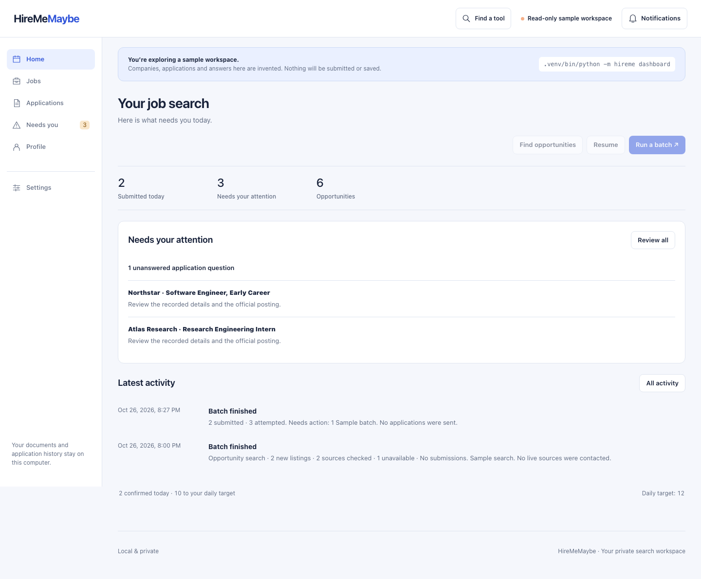

# HireMeMaybe

**A self-hosted AI agent that finds jobs, builds tailored applications, submits supported applications, and tracks the results.**

I got tired of applying to the same kinds of jobs, day after day, and entering the same information, application after application.

So I built HireMeMaybe to help with the repetitive parts.

It's a private job application workspace that runs where you choose: locally on macOS or Linux, in a supported Linux environment on Windows, or on an optional Raspberry Pi. Bring your own documents, approved context and model connection. It helps you find openings, prepare answers and cover letters from information you've confirmed, submit supported applications, and keep track of what happened.

The direction is a complete job-search feedback loop: applications, their exact materials, recruiting responses and a clear next step in one place. The [roadmap](docs/feedback-loop.md) distinguishes what's implemented from the networking and strategy work still ahead.



[Try the sample workspace](#try-it-without-personal-data), [make it yours](#make-it-yours), or [help build it](CONTRIBUTING.md). The screenshot uses invented data; see its [provenance](docs/images/application-desk-demo.provenance.md).

## Get started

Requires **Python 3.11+**, Git, and macOS or Linux. Windows users need a supported Linux environment such as WSL2. For Raspberry Pi OS, follow the [Pi guide](docs/pi.md).

On **Intel Macs**, the pinned cryptography dependency builds from source. Install the Xcode Command Line Tools (`xcode-select --install` if needed), Rust and OpenSSL 3 before setup. With Homebrew, use `brew install rust openssl@3`; see the dependency's [macOS build instructions](https://cryptography.io/en/50.0.2/installation/#building-cryptography-on-macos) for other options.

```bash
git clone https://github.com/hoverdart/please-hire-me.git
cd please-hire-me
./setup.sh
```

Setup installs pinned dependencies and Chromium, starts the dashboard, and opens your browser when available. Use the printed dashboard URL, including its token. Keep the terminal open; **Ctrl+C** stops the dashboard. If Linux browser libraries are missing, install them with `.venv/bin/python -m playwright install-deps chromium` using an account allowed to install OS packages.

To start it again after installation:

```bash
cd please-hire-me
.venv/bin/python -m hireme dashboard --open
```

Complete the setup checklist:

1. Upload a resume PDF with selectable text. A transcript is optional.
2. Review extracted facts and confirm them. Supply missing information, including work authorization and sponsorship.
3. Add context and writing samples, then review and approve how each source may be used.
4. Choose search preferences, company limits, batch timing and request limits.
5. Connect a supported subscription CLI or explicitly choose paid API billing.
6. Finish paused. Review prepared drafts before enabling automatic submissions.

Your documents, credentials and history live outside the checkout in `~/.local/share/please-hire-me/`. Setup can be resumed later. Choosing Pi in setup does not transfer your files to another machine.

For a different private workspace, put the same absolute `--data-dir` before **every** subcommand, including the dashboard, Gmail and scheduling commands:

```bash
.venv/bin/python -m hireme --data-dir /absolute/path/to/private-workspace dashboard --open
```

A checkout is code; the private workspace is your applicant identity and history. Move between machines with a [history backup and restore](docs/guide.md#back-up-and-move-your-data), then reconnect credentials on the destination. Use one active worker per applicant.

## Try it without personal data

After installing dependencies:

```bash
.venv/bin/python -m hireme demo
```

Open the printed URL. The sample workspace is temporary and read-only, uses invented records, and makes no model requests or applications. **Ctrl+C** removes its sample data. It uses port 8767; the regular dashboard uses 8766.

## Make it yours

Set it up for the jobs you want and the way you want to apply:

- **Your search:** choose roles, seniority, locations, compensation requirements and companies to skip in **Settings → Search & automation**. The current defaults focus on internships and new-grad software, ML and research roles; review the season and location settings too.
- **Your information:** upload your own resume, confirm extracted facts and save answers you're comfortable reusing. Missing personal details stay unanswered until you supply them.
- **Your writing:** add project context and writing samples in **Profile → Materials**, then approve how each source can be used. Style examples help with wording; they don't establish qualifications.
- **Your resumes:** confirm education and employment in **Your facts**, including complete experience lines under each role. Enable **Tailored resumes** to select relevant lines for each posting and generate a versioned PDF for supported browser applications. Your original stays available.
- **Education forms:** confirmed education records can fill supported Ashby history sections, including degree, major, month/year dates and current-study status. Unknown required details stay queued for review.
- **Your experience:** use **Import history from your resume** in Your facts to review exact PDF excerpts and proposed employment or education fields. Correct them and explicitly confirm each entry; previews do not become facts automatically.
- **Your pace and budget:** choose the model connection, batch interval, company limits and attempt/request ceilings. Start paused and review prepared drafts before enabling submissions.

The [user guide](docs/guide.md#set-it-up-for-your-search) walks through these choices. Keep personal files in the private workspace outside Git; the examples in this repository are only references.

## Everyday use

Use **Find a tool** or **Ctrl/⌘ K** to locate tasks in the workspace.

| Task | Where to go |
| --- | --- |
| Find jobs, prepare drafts or review progress | **Jobs** |
| Review submission outcomes, recruiting progress or batch history | **Applications** |
| Answer held questions or check uncertain outcomes | **Needs you** |
| Update a resume or confirmed information | Profile → **Your facts** |
| Add writing examples or project context | **Profile → Materials** |
| Change search targets, limits, timing or model settings | **Settings → Search & automation** / **Connections** |
| Back up history | Settings → Search & automation → **Your data and backups** |
| Find applications made outside the app | Connections → **Past applications from email** |

**Pause** stops work at cancellation checkpoints; a request already sent to an employer cannot be undone. Unknown outcomes and email-verification challenges stay held for review. Verify them with the employer before recording a result.

For setup problems:

```bash
.venv/bin/python -m hireme doctor
.venv/bin/python -m hireme doctor --verify-login
```

These checks send no model requests or applications. See the [user guide](docs/guide.md#troubleshooting) for dashboard restarts and recovery.

## Run while you're away

Once you've reviewed your facts, documents, prepared drafts and limits, you can enable automatic applications and install the saved schedule:

```bash
.venv/bin/python -m hireme doctor --verify-login
.venv/bin/python -m hireme schedule install
.venv/bin/python -m hireme resume
.venv/bin/python -m hireme schedule status
```

These commands enable applications at your saved interval; they do not start an immediate batch. To run a batch now, use `.venv/bin/python -m hireme run`. Review its results in Applications. A blocked question or CAPTCHA stays held while the worker continues with other eligible jobs. An uncertain submission stays held for reconciliation.

macOS uses a user LaunchAgent; Linux uses cron or an existing systemd worker timer. The computer must remain awake and the user session or Linux environment must be running. Scheduled work is separate from the dashboard: closing a browser tab does not stop the worker, and stopping the dashboard terminal does not remove its schedule. Use one scheduler per applicant; `daemon` is a foreground alternative, not an additional schedule.

To pause applications, run `.venv/bin/python -m hireme pause`. To remove automatic runs, also run `.venv/bin/python -m hireme schedule uninstall`. [Scheduling and recovery](docs/guide.md#pause-schedule-and-recover) explains the controls and where to inspect results.

## Check your application email

Gmail is optional and requires its own OAuth connection under **Connections → Email automation**. Browser sign-in alone does not connect it. Enable reports, recruiting feedback, verification codes and past-application checks separately; see [Gmail setup](docs/guide.md#gmail-and-employer-accounts).

With **Check Gmail for past applications** enabled, the worker checks an employer's historical email before applying. Exact posting links or a complete company and role match hold duplicates, including applications made outside HireMeMaybe. Matching preserves internship year, seniority and location when they appear in the role title. A generic company acknowledgement stays available for review rather than marking every role at that company as applied.

Use **Past applications from email** to scan an employer or build a broader historical index. The first scan includes archived mail, and each page saves its position. Continue when more mail remains; if Gmail limits access, retry later from the saved position. Review the original message and select an exact saved role when needed. These email records remain separate from the worker's submission outcomes. Email text stays out of model prompts.

## What to expect

- Supported submission flows send the final application and look for a fresh receipt and matching acknowledgement. The ledger keeps prepared, confirmed, not-submitted and uncertain outcomes separate; stable-release employer validation is still outstanding.
- Optional tailored resumes use confirmed education, employment and skills, preserving the wording and employer context of selected experience. They require no extra model calls. Generated PDFs and earlier revisions remain downloadable per job.
- Answers use confirmed facts, scoped saved responses and approved personal sources. Missing legal, identity or demographic facts require your input.
- Model inference uses your selected remote provider. Claude Code and Codex subscription modes reject API-only authentication; paid API usage must be selected explicitly. Request counters measure this worker's usage, not your vendor balance.
- Submission budgets, durable intents and local locks limit work and preserve uncertain outcomes across restarts.
- Login walls, CAPTCHA, unknown questions, unsupported controls and ambiguous receipts need manual review. Discovering an ATS posting does not establish support for its application form.
- An optional visible-browser wait lets you complete a post-click challenge on compatible Ashby forms within the existing attempt. It starts disabled and is capped at 600 seconds. The worker does not solve the challenge or retry an uncertain application.
- Optional Gmail handles recognized Greenhouse verification codes, batch reports and recruiting-feedback suggestions. Review matching acknowledgements, assessments, interviews, rejections and offers against an exact application attempt. Inbox text stays out of models, and reviewed feedback never changes submission status or authorizes a retry.
- Opt-in Gmail history checks find past applications made outside this app. Exact posting or company/role matches hold duplicate applications before the browser opens; company-only mail can be linked to an exact saved role after review. The first scan includes archived mail without a date cutoff.
- **Answers & evidence** joins an attempt's posting identity, exact document references, submission outcome, reviewed recruiting feedback and next action. Export its private JSON record or download the original recorded PDFs. New attempts capture posting identity; older records clearly label unavailable historical context.
- **Recruiting Insights** in Applications compares reviewed responses by company, exact role title, source and resume PDF. Choose a response window and inspect the attempts behind each metric. Recent or uncertain submissions do not enter mature-response denominators; missing feedback is not a rejection.

The configured release-candidate version is **0.5.0rc8**. Download published candidates from [GitHub Releases](https://github.com/hoverdart/please-hire-me/releases). Stable-release validation remains incomplete; see the [release status](docs/public-release.md) for capability limits and remaining gates. Each applicant runs a private local instance.

## Guides and development

If you're trying it for your own search, the user guide is the next stop. If you want to improve the app, start with Contributing. Clearer docs and reproducible form bugs are useful contributions too.

- [User guide](docs/guide.md): documents, drafts, questions, models, scheduling, backups and Gmail.
- [Raspberry Pi guide](docs/pi.md): setup, background services, restart and upgrades.
- [Operations and encrypted backups](docs/operations.md): local health checks, off-device recovery and an optional Mac-owned Pi monitor.
- [Privacy](PRIVACY.md) and [security reporting](SECURITY.md): where your information goes and how to report a problem privately.
- [Documentation map](docs/README.md): architecture, platform connections and contributor references.
- [Contributing](CONTRIBUTING.md): local tests, packaging checks and safe fixture development.
- [AutoApply comparison](docs/autoapply-comparison.md): source-reviewed ideas, implemented improvements and the next priorities.

This project began as a fork of [alecswang/please-hire-me](https://github.com/alecswang/please-hire-me). The original MIT license and attribution remain in [LICENSE](LICENSE).
